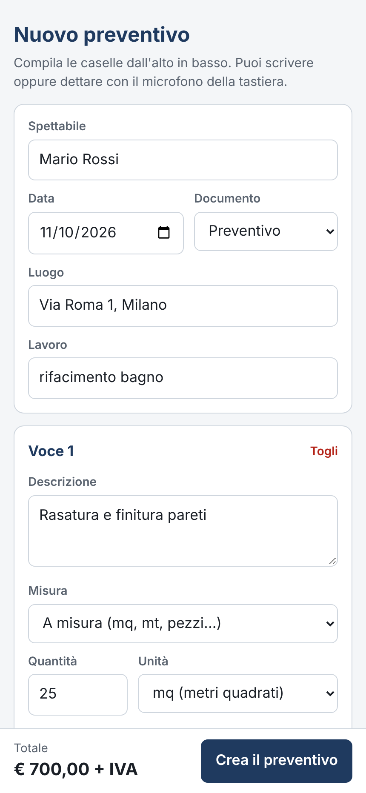

# quote-builder

A web page that helps a small construction company prepare quotes
(*preventivi*) and final statements of work (*consuntivi*). You fill in (or
dictate) a few fields, and the program does the math, cleans up prices and
addresses, fixes the Italian and creates the Word document in the company's
layout.

The page, the documents and the code are in Italian, because the user and the
domain are.



## The problem

I built it to help my father, who runs a small construction company. He knows
what goes into a quote, but typing it up and formatting it on a computer takes
him a long time, so documents pile up. Documents made by hand also end up with
sum and formatting errors.

The tool is in use: **the first real quote, sixteen items, was filled in in about
five minutes.**

## How it works

1. **Fill in the page.** Client, date, site, job, then the line items. Every
   field can be typed or dictated with the keyboard's microphone.
2. **The code cleans up and checks.** `593€` becomes `€ 593,00`, and
   `via ponte 33 robecco sul naviglio milano` becomes
   `Via Ponte 33, Robecco sul Naviglio, MI`. The total updates while you type.
3. **If needed, fix the Italian.** If a Gemini key is configured, a button
   sends only the job descriptions to a language model (Gemini), which
   corrects spelling and grammar. Under each changed text the original stays
   visible, and you can switch back to it.
4. **Download the Word file.** If something is missing, the document comes out
   as a draft (BOZZA), with the fields still to complete highlighted in yellow.

A line item can be a lump sum (*a corpo*), priced by measure with a unit price
(*a misura*), or priced by measure with an agreed total.

## Design choices

Every decision, with its reason, is in [DECISIONS.md](DECISIONS.md),
including the ones later abandoned. The main ones:

- **The code does the math, never the model.** Amounts and totals are computed
  in Python with exact decimals (`Decimal`), because with ordinary
  floating-point numbers some products came out one cent off.
- **The language model suggests, the code checks.** A correction that changes a
  number, or makes the text much longer or shorter, is discarded: in a quote,
  everything written is a commitment to the client.
- **Only job descriptions reach the model.** Names, addresses and prices are
  never sent to it.
- **Errors and missing data are different things.** Badly written data blocks
  the document; missing data produces a draft.
- **Closed until configured.** If no password is set, the page does not open.

## Structure

| File | What it does |
|---|---|
| `genera_preventivo.py` | Checks the data, does the math and writes the Word file from the template |
| `pulizia.py` | Cleans up prices, quantities, addresses and units of measure |
| `correzione.py` | Asks Gemini to correct the descriptions and checks the answer |
| `app.py` | The web page (Flask): password login, preview, Word creation |
| `templates/` | HTML for the page and for the login screen |
| `tests/` | Automated tests |
| `examples/` | An invented quote, draft and company |

## Running it

```bash
python3 -m venv .venv
source .venv/bin/activate
pip install -r requirements.txt
cp .env.example .env
```

In `.env`, choose a password for the page (`PASSWORD_PAGINA`, at least 8
characters). The Gemini key is optional: without it, everything works except
the text correction. Then:

```bash
python app.py
```

and open `http://127.0.0.1:8000` in the browser. You can also create a Word
file without the page, from a data file:

```bash
python genera_preventivo.py examples/preventivo_esempio.json
```

Tests run with `python -m pytest`. None of them uses the internet or a real
key: Gemini is replaced by a fake answer.

Online, the program runs with Gunicorn (`gunicorn app:app`) and reads the
password, the key and the company's data from environment variables instead of
the `.env` file.

## Known limitations

- Reloading the page loses what has been typed.
- A quote that has already been created can't be reopened for editing.
- The page can't yet add alternative items (*in alternativa*) or notes, which
  the Word generator already supports.
- Address cleanup follows rules: it works for the most common Italian
  addresses, not for all of them.
- There is a single password, shared by everyone who uses the page.
- Online, on Render's free plan, the page shuts down after 15 minutes without
  use, and the first visit afterwards takes about a minute.
- The text correction is currently switched off in the online version: Google's
  terms require the paid tier when someone else uses the page, and it isn't
  worth it yet (see [DECISIONS.md](DECISIONS.md)).

## Data

The repository contains no real documents, clients or prices: the examples are
invented. The company's real data and the quotes are kept outside Git.

## How it was built

This is my first project of this kind. The code was written by an AI assistant
(Claude), following my directions. My part was understanding the problem
together with my father, who uses the tool; deciding what it should and
shouldn't do (the choices and their reasons are in
[DECISIONS.md](DECISIONS.md)); testing every version with him and reporting
the problems; and putting it online. The Python files are commented line by
line in Italian, because one of the goals was to understand all of the code.
